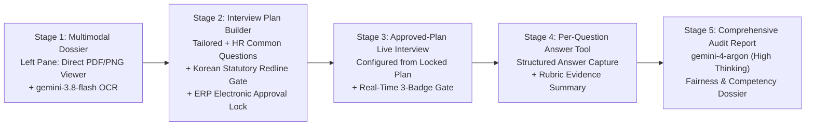

# FairPanel: Phase 1 Completion & Phase 2 End-to-End HITL Workflow Plan

> **Updated:** 2026-10-16T12:58+09:00
> **Document Hierarchy:**
> - **P0 (Primary Legacy):** Official Google DeepMind AI Hackathon Guide (`13hG3aETJ54oKULF3JZUgM5VYHv7o2ZM4a4AZeqinbRg` — *Overview, Schedule, Resources, Gemini 4 Argon Builder Guide*)
> - **P1 (Secondary Legacy):** FairPanel Hackathon Execution Architecture Spec + Official Verification Text Pack (`demo_questions_20.txt`, `expected_results_20.txt`, `kit_validation_cases.txt`, `original_testset_20.txt`, `sample_jd.txt`, `sample_resume.txt`, `verification_guide.txt`)
> - **P2 (Baseline 1st Module Plan):** AI Studio 1st Module Implementation Plan (revised below)

---

## 1. End-to-End 5-Stage Human-in-the-Loop (HITL) Workflow Architecture

FairPanel implements a complete, reproducible **5-Stage Human-in-the-Loop (HITL) Fair Hiring Pipeline** combining multimodal document ingestion, pre-interview plan governance, live interview assistance, per-question answer summarization, and post-interview fairness auditing:

### Split-Screen Workspace Design (`Left: Dossier Viewer` | `Right: Plan & Interview Copilot`)
1. **Left Column — Direct Visual Resume / Portfolio / JD Viewer + Multimodal OCR (`gemini-3.8-flash`)**:
   - Directly renders the candidate's **Resume** and **Additional Portfolio PDF/PNG** (`public/samples/sample_resume_fp_c01..c03.pdf/.png`, `sample_portfolio_fp_c01..c03.pdf/.png`) and **Job Description** (`sample_jd_fp_works.pdf/.png`) so the interviewer can visually read the original documents side-by-side.
   - Provides 1-click **Multimodal OCR (`POST /api/parse-doc` via `gemini-3.8-flash`)** to extract structured text and highlight core competencies (`C1`–`C5`).
2. **Right Column — Stage-by-Stage HITL Copilot**:
   - **Pre-Interview Plan Formulation (`Candidate-Tailored Questions + HR Mandatory Common Questions`)**:
     - The interviewer formulates the question plan while reading the left-hand Resume/Portfolio, merging candidate-specific behavioral questions with **HR Mandatory Common Questions** into one unified **Interview Plan**.
     - **Statutory Fairness & Transparency Constraints**: Every planned question is audited against Republic of Korea employment statutes (`Fair Hiring Procedure Act Art. 4-3`, `Equal Employment Opportunity Act Art. 7(2)`, `Age Discrimination Act Art. 4-4`, `NHRC Act Art. 2(3)`), explicitly displaying `✅ ALLOWED IN PLAN` vs. `🚫 DO NOT ASK — PROHIBITED STATUTORY REDLINE`.
     - **ERP Electronic Approval Integration (Accountability Lock)**: Includes a conceptual **ERP Approval Sign-off (`ERP Approval Ready / Accountability Lock`)** badge. Once approved, the Interview Plan is locked and configures the Live Interview workspace.
   - **Live Interview Execution & Per-Question Answer Summarization Tool**:
     - Driven directly by the locked Interview Plan.
     - Provides a **Per-Question Answer Capture & AI Summarization Tool** so the interviewer can record/summarize the candidate's response for each planned question and align behavioral evidence to the 1–5 scoring rubric.
     - Intercepts any ad-hoc follow-up questions via the **Real-Time 3-Badge Question Gate** (`gemini-3.5-flash-lite` Stage 1 -> `gemini-4-argon` Stage 2 + Deterministic Statutory Guard).
   - **Final Comprehensive Evaluation & Fairness Audit Report (`POST /api/report`)**:
     - Uses `gemini-4-argon` (`ThinkingLevel.HIGH`) to synthesize all per-question answer summaries, competency scores (`C1`–`C5`), intercepted risk logs, and ERP plan approval metadata into a final decision report.

---

## 2. Phase 1 Completion Checklist (Spec & Reproducibility Alignment)

1. **100% Deterministic Demo Reproducibility (`server.ts`, `src/utils/checks.ts`)**:
   - Removed naive pre-LLM keyword short-circuits that falsely flagged technical/HR-ops questions.
   - Implemented `isTechnicalOrHrOpsContextSafe` and `isNeutralJobRequirementQuestion` + post-LLM statutory ground-truth reconciliation (`alignRiskWithStatutoryGroundTruth`) so that:
     - `S03` (maternity/parental leave HR data access permissions), `S04` (posted schedule confirmation), and `S05` (primary key design when merging department HR data) deterministically resolve to `level: 'none'`.
     - `S06` (compound), `S07` (leading), and `S08` (vague) deterministically flag `qualityStatus: 'compound' | 'leading' | 'vague'`.
     - `S09`–`S12` (commute distance, personality probe, team dinner drinking capacity, weekend companions) deterministically resolve to `level: 'caution'` with **`lawRefs: []` (empty array)**.
     - `S13`–`S20` and `B01`–`B10` deterministically resolve to `level: 'high'` with exact statutory `lawRefs`.
2. **Model Routing & `@google/genai` Contract (`server.ts`)**:
   - Primary reasoning & verification loops: `gemini-4-argon` (`ThinkingLevel.MEDIUM` / `ThinkingLevel.HIGH`).
   - Multimodal PDF/PNG OCR & section coaching: `gemini-3.8-flash` (`ThinkingLevel.LOW`).
   - High-throughput Stage-1 risk triage: `gemini-3.5-flash-lite` (`ThinkingLevel.LOW`).
   - Zero legacy sampling parameters (`temperature`, `topP`, `topK`).
3. **100% English Submission & Multi-Candidate Assets**:
   - All 14 PDF/PNG documents in `public/samples/`, all 3 candidate presets (`FP-C01`, `FP-C02`, `FP-C03`), all benchmark suites (`B01`–`B20` and `S01`–`S20`), all defect cases (`K01`–`K05`), and all UI views are in 100% English.
