# FairPanel — Real-Time Structured Interview & Legal/Bias Verification Copilot

> **Google DeepMind AI Hackathon — Build with Gemini 4 Argon (Seoul, Oct 2026)**
> **Primary Reasoning Engine:** `gemini-4-argon` | **Companion Models:** `gemini-3.8-flash` & `gemini-3.5-flash-lite`
> **Live Google Cloud Run URL:** [https://fairpanel-401108022555.asia-northeast3.run.app](https://fairpanel-401108022555.asia-northeast3.run.app) (`Project: h2gdm-hack26icn-2609`, `Region: asia-northeast3`)
> **Human-in-the-Loop Governance Log:** [`HITL_DECISION_LOG.md`](./HITL_DECISION_LOG.md) | **Agent Harness:** [`GEMINI.md`](./GEMINI.md)

---

## 1. Problem & Impact Framing (Why FairPanel Matters)

Unstructured job interviews expose both employers and candidates to severe compliance, fairness, and signal-quality failures:

1. **Statutory & Discrimination Exposure**: Interviewers frequently ask ad-hoc questions regarding marital plans, pregnancy/childbirth, family occupation/assets, physical appearance, or age hierarchy. Under Korean labor law, these trigger risk across:
   - **Fair Hiring Procedure Act, Article 4-3 (`채용절차의 공정화에 관한 법률 제4조의3`)**: Directly prohibits demanding job-irrelevant physical conditions (appearance, height, weight), region of origin, marital status, personal assets, or family members' education/occupation/assets in basic screening documents (`기초심사자료`) at workplaces with **$\ge 30$ employees** (`상시 30인 이상 사업장`), and asking such questions orally in interviews violates the statutory intent (`면접 구두 질문은 법 취지상 위반 소지 및 제한 권고`).
   - **Equal Employment Opportunity Act, Article 7 (`남녀고용평등법 제7조 제2항`)**: Prohibits discriminating on gender or demanding physical conditions or unmarried status not required for the job from **workers (`근로자`)**.
   - **Age Discrimination in Employment Act, Article 4-4 (`고령자고용법 제4조의4`)**: Prohibits age-based discrimination or hierarchy/adaptability presumptions in recruitment and hiring.
   - **National Human Rights Commission Act, Article 2(3) (`국가인권위원회법 제2조 제3호`)**: Defines unreasonable differential treatment based on gender, religion, age, region of origin, marital/pregnancy status, family form, or political opinion in employment as a discriminatory act.
2. **Low-Signal Question Quality**: Even legally safe questions often fail structured interview standards due to **compound queries** (`복합 질문`), **leading phrasing** (`유도 질문`), or **vague non-behavioral prompts** (`모호 질문`).
3. **Asymmetric Candidate Vulnerability**: When a candidate faces an invasive or inappropriate question in a live interview, they have seconds to respond without sacrificing their candidacy or over-disclosing protected personal data.

**FairPanel** transforms unstructured interviewing into an **auditable, 4-stage agentic workflow** that simultaneously protects **Interviewers**, **HR Governance Teams**, and **Candidates**.

---

## 2. Multi-Model Agentic Architecture (`gemini-4-argon` + Companion Models)

FairPanel is built as a **multi-step verification and escalation loop**, pairing `gemini-4-argon`'s deep legal/contextual reasoning with the low latency of `gemini-3.5-flash-lite` and multimodal speed of `gemini-3.8-flash`:

```mermaid
flowchart TD
  subgraph S1["Step 1: Interview Kit Generation & 5-Criterion Verification Loop"]
    D1["JD + Resume Input\n(PDF/Image/Text)"] -->|"gemini-3.8-flash\n(thinking_level: low)"| P1["Structured Extraction\n(/api/parse-doc)"]
    P1 -->|"gemini-4-argon\n(thinking_level: medium)"| K1["Step A/B: Extract C1–C5 Competencies\n& Draft 5 Behavioral Questions + 1/3/5 Rubrics"]
    K1 --> V1["Step C: 5-Criterion Deterministic + Semantic Audit\n(1. Legal, 2. Job-Relevant, 3. Behavioral, 4. Single, 5. Non-Leading)"]
    V1 -->|"Failed Items Only\n(e.g., K01–K05)"| R1["Step D: Targeted Argon Repair Loop\n(gemini-4-argon -> Round 2 Re-Verification)"]
    V1 -->|"0 Failures"| K2["Verified Structured Kit Ready"]
    R1 --> K2
  end

  subgraph S2["Step 2 & 3: Two-Stage Live Question Gate & Candidate Protection"]
    Q1["Live Interviewer Draft Question\n(e.g., S01–S20)"] -->|"Stage 1 Fast Triage\ngemini-3.5-flash-lite (low)"| G1{"Risk != none OR\nQuality != ok OR\nAmbiguous Context?"}
    G1 -->|"No (Safe & High Quality)"| B0["3-Badge Pass:\nNONE | 적합 | 역량 중심 답변"]
    G1 -->|"Yes (Escalate)"| G2["Stage 2 Deep Contextual & Statutory Judge\ngemini-4-argon (thinking_level: medium)"]
    G2 --> B1["Badge 1: Legal/Policy Risk\n+ Statutory Scope Note"]
    G2 --> B2["Badge 2: Question Quality\n+ 1-Click Behavioral Rewrite"]
    G2 --> B3["Badge 3: Candidate Answer Strategy\n+ Polite Boundary Script & Pivot Points"]
  end

  subgraph S4["Step 4: Post-Interview Fairness & Competency Audit Report"]
    T1["Session Transcript + Intercepted Risk Log\n+ Rubric Rationale Bias Audit"] -->|"gemini-4-argon\n(thinking_level: high)"| AR["Executive Fairness & Competency Coverage Report\n(POST /api/report)"]
  end
```



### Model Routing Summary

| Endpoint / Module | Model ID | `thinking_level` | Role in Agentic Loop |
| :--- | :--- | :--- | :--- |
| `POST /api/kit` (Step B & Step D) | `gemini-4-argon` | `medium` | Extracts `C1`–`C5` competencies, drafts behavioral questions + 1/3/5 rubrics, and repairs **only** failed items in Round 2. |
| `POST /api/risk` (Stage 1 Triage) | `gemini-3.5-flash-lite` | `low` | Sub-second first-pass risk & question-quality classification. |
| `POST /api/risk` (Stage 2 Escalation) | `gemini-4-argon` | `medium` | Contextual disambiguation (e.g., distinguishing HR-ops maternity data access `S03` from personal pregnancy probes `S14`), statutory mapping, and behavioral rewrite. |
| `POST /api/rewrite` | `gemini-4-argon` | `medium` | Converts risky, compound (`S06`), leading (`S07`), or vague (`S08`) questions into neutral behavioral questions with 1/3/5 rubrics. |
| `POST /api/candidate-guide` | `gemini-4-argon` | `low` / `medium` | Generates real-time Candidate Answer Strategy (`공개 범위 설정 권고`, polite refusal/boundary script, job-strength pivot points, and MOEL/NHRC redress channels). |
| `POST /api/parse-doc` & `/api/section-coach` | `gemini-3.8-flash` | `low` | Multimodal PDF/image/text JD & Resume parsing and resume section coaching. |
| `POST /api/report` | `gemini-4-argon` | `high` | Synthesizes post-interview competency coverage (`C1`–`C5`), intercepted risks, rubric bias checks, and actionable governance recommendations. |

---

## 3. Key Features & The 3-Badge Live Question Gate

Every question inspected in FairPanel produces **three synchronized verification badges**:

1. **Badge 1 — Legal & Policy Risk (`법적·정책 위험`)**:
   - Classifies questions into `NONE (권장)`, `MEDIUM / CAUTION (주의)`, or `HIGH RISK (고위험)`.
   - Context-aware: Correctly passes legitimate technical/HR-ops questions containing sensitive substrings, such as **`S03`** (`"출산휴가·육아휴직 데이터의 접근권한을 관리했던 방법을 말씀해 주세요."` -> `NONE`), **`S04`** (`"공고에 안내된 분기 말 정산 집중기간 일정에 참여 가능한지 확인 부탁드립니다."` -> `NONE`), and **`S05`** (`"부서별 인사데이터를 병합할 때 기준 키 값을 어떻게 설계하셨나요?"` -> `NONE`).
   - Statutory precision: Distinguishes between statutory violations (`recruit_4_3`, `gender_7`, `age_4_4`, `nhrc_2_3`) and job-irrelevant personal privacy questions where no direct statute applies (**`S11`** drinking habits and **`S12`** weekend companions -> `MEDIUM / CAUTION` with `lawRefs: []`).
2. **Badge 2 — Question Quality (`질문 품질`)**:
   - Detects **`복합 질문 (Compound)`** (`S06` / `K02`), **`유도 질문 (Leading)`** (`S07` / `K03`), and **`모호 질문 (Vague / Non-Behavioral)`** (`S08` / `K04`), offering a 1-click `gemini-4-argon` behavioral rewrite.
3. **Badge 3 — Candidate Answer Strategy (`지원자 답변 가이드`)**:
   - Provides `역량 중심 답변` for valid questions and `공개 범위 설정 권고` (with polite boundary scripts, competency pivot points, and post-interview MOEL/NHRC consultation channels) for medium/high-risk questions.

---

## 4. Dual 20-Item Verification Benchmarks (`B01`–`B20` & `S01`–`S20`)

FairPanel ships with two separate, independently verifiable 20-question evaluation suites (never artificially merged into a `40/40` score):

1. **Live Demo 20-Question Suite (`S01`–`S20`, `demo_questions_20.txt` + `expected_results_20.txt`)**:
   - `S01`–`S05`: Safe behavioral & context-exception questions (`S03` maternity data access, `S04` posted schedule check, `S05` database merge key).
   - `S06`–`S08`: Question quality defects (`S06` compound, `S07` leading, `S08` vague).
   - `S09`–`S12`: Medium/caution risk (`S09` commute distance, `S10` personality binary, `S11` drinking, `S12` weekend privacy).
   - `S13`–`S20`: High-risk statutory/discrimination probes (marriage, childbirth, family occupation, hometown, housing assets, height/weight/appearance, age/younger lead, gender/overtime).
2. **Fixed Benchmark 20-Question Suite (`B01`–`B20`, `original_testset_20.txt`)**:
   - 10 High-Risk + 10 Safe benchmark questions (`20/20` deterministic & LLM-backed verification).
3. **Kit Defect Repair Cases (`K01`–`K05`, `kit_validation_cases.txt`)**:
   - Interactive HR Admin demo proving Round 1 failure detection and Round 2 targeted `gemini-4-argon` repair.

---

## 5. Quick Start & Verification

### Prerequisites
- Node.js 20+
- `GEMINI_API_KEY` environment variable set in `.env.local` or shell environment

### Local Setup & Execution
```bash
# 1. Install dependencies
npm install

# 2. Run deterministic unit & benchmark tests (B01-B20 & S01-S20)
npm test

# 3. Start full-stack server (Express API + Vite React UI on port 3000)
npm run dev
```

### Google Cloud Run Deployment (`h2gdm-hack26icn-2609`)
```bash
gcloud run deploy fairpanel \
  --project h2gdm-hack26icn-2609 \
  --source . \
  --region asia-northeast3 \
  --allow-unauthenticated \
  --set-env-vars="GEMINI_API_KEY=${GEMINI_API_KEY}" \
  --quiet
```

---

## 6. Human-in-the-Loop (HITL / HITR) Co-Reasoning Log

All architectural decisions, statutory accuracy calibrations, model routing choices (`gemini-4-argon` for verification/judgment/orchestration vs `gemini-3.8-flash` for parallel coding and parsing), and bug fixes discovered during the hackathon are transparently documented in [`HITL_DECISION_LOG.md`](./HITL_DECISION_LOG.md).
